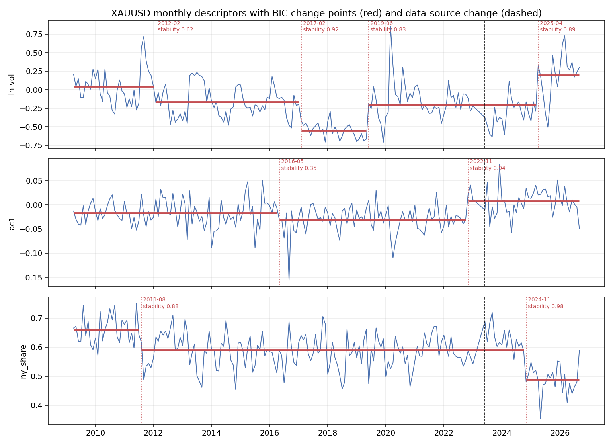
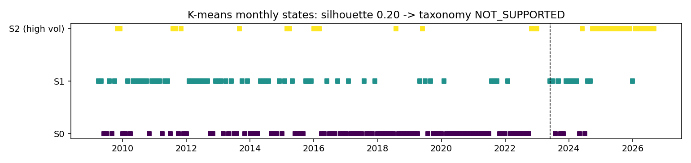
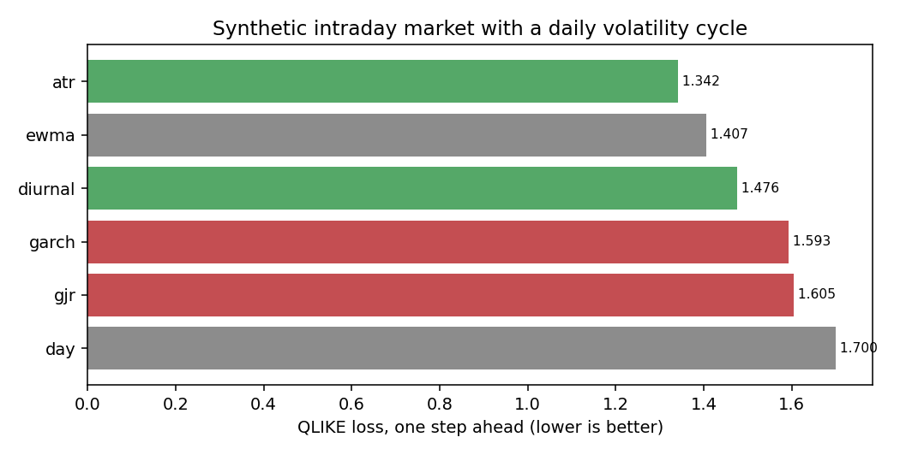

# Gold volatility regimes: what 17 years of intraday gold really show

[](https://github.com/Tolbert-Okoth/gold-volatility-regimes/actions/workflows/tests.yml)


"Regimes" are everywhere in trading content: bull, bear, choppy, trending, high-vol, low-vol. Few people test whether those labels describe anything real. `volregime` is a small toolkit for doing it properly, applied to **XAUUSD 5-minute data from 2009 to 2026** (206 months).

The toolkit has four parts:
- **descriptors:** five intraday market measurements per month, computed with no look-ahead;
- **exact structural breaks:** an optimal segmentation, with bootstrap stability for every break date;
- **recurrent states:** clustering judged by **rules fixed before looking**;
- **a volatility-forecaster shoot-out:** QLIKE loss, block-bootstrap confidence intervals and Mincer–Zarnowitz calibration slopes.



## Findings

### 1. Gold's intraday behaviour has changed, but in dated steps, not in recurring states

| Descriptor | Break dates (bootstrap stability) | What changed |
|---|---|---|
| Volatility (log, % per day) | 2012-02 (0.62), **2017-02 (0.92)**, **2019-06 (0.83)**, **2025-04 (0.89)** | Low plateau 2017–19 (0.58 %/day); high since 2025-04 (1.22 %/day) |
| 5-min lag-1 autocorrelation | 2016-05 (0.35), **2022-11 (0.94)** | Mild mean reversion (−0.03) turned to **≈ 0 / slightly trending** from late 2022 |
| New York 08:00–17:00 share of daily variance | 2011-08 (0.88), **2024-11 (0.98)** | Dropped from 0.59 to **0.49**: since late 2024, half of gold's daily movement happens outside New York hours |

The break dates were not chosen by eye. Each is an exact, globally optimal least-squares segmentation, chosen by BIC, with a minimum of 18 months per segment. A moving-block bootstrap then measures how often each date reappears. The 2022-11 and 2024-11 breaks are robust (≥ 0.94).

### 2. The neat "3-regime taxonomy" does not survive its own test

K-means with K = 3 on the five descriptors always returns three clusters. Before looking, I fixed the rules for calling them real regimes: stable when one era is held out (agreement ≥ 0.75), and **separated (silhouette ≥ 0.25)**.

| Check | Result |
|---|---|
| Held-out agreement, each of 5 eras | 0.96 – 1.00 ✅ |
| Silhouette | **0.20** ❌ (clusters overlap) |
| **Verdict** | **Taxonomy NOT_SUPPORTED** |

Two of the three "states" have *identical* volatility and alternate month to month. The third is mostly the single 2025–26 episode. What recurs over 2009–2024 is **one broad normal market**, whose volatility varies.



### 3. 2025–26 is new in structure, not in percentage volatility

Compared with the 37 most volatile earlier months (2009–11, 2013, March 2020), 2025–26 has:
- **similar volatility in % terms**: 1.19 vs 1.25 %/day, with the CI including 0;
- **positive autocorrelation** where earlier volatile periods were mean-reverting;
- **higher efficiency**: price moves were straighter, with less back-and-forth;
- **a much lower New York share**: 0.49 vs 0.58.

In **dollars** it is unprecedented: about $34–66 a day, against $8–19 in 2009–2024. Gold's price is 3–4× higher. Percentage and dollar volatility are different things, and anything priced in dollars (spreads, stops, commissions) feels the dollar version.

### 4. Plain GARCH loses to a scaled ATR intraday

On 2020–26 gold 5-minute data (about 470k bars, re-fitted every quarter on the trailing year), one-step QLIKE, lower is better:

| Scaled ATR(14) | GARCH(1,1) | GJR-GARCH | EWMA 0.94 | Trailing day | Time-of-day |
|---|---|---|---|---|---|
| **1.493** | 1.500 | 1.500 | 1.562 | 1.734 | 2.008 |

| Comparison | GARCH − ATR difference |
|---|---|
| 1 step ahead | +0.007, CI [+0.001, +0.013] |
| 12 steps ahead | +0.20, CI [+0.10, +0.34] |

Both differences exclude zero. The fitted GARCH persistence α + β has a median of **1.000**, an integrated process. The model reads gold's daily volatility cycle as persistence. Its Mincer–Zarnowitz slopes of 0.26–0.72 show its forecasts swing too much.

The underlying price data is licensed, so it isn't shipped. But [`examples/forecast_shootout.py`](examples/forecast_shootout.py) reproduces **the mechanism** on a synthetic market with a daily volatility cycle. There too, GARCH comes out integrated (persistence 1.00) and loses to ATR, with a CI that excludes zero.



> **Lesson:** on intraday data, remove the time-of-day pattern first (a multiplicative/diurnal GARCH, or HAR on realised variance). Otherwise a 14-bar ATR, often dismissed as a "retail" indicator, is the stronger baseline.

### 5. Hidden Markov "regimes" mostly re-describe volatility

In a related study, 2- and 3-state Gaussian HMMs were fitted on intraday features, causally and year by year from 2022 to 2026. A plain linear function of log realised volatility explained **58–65 %** of the 2-state filtered probabilities in 2022–25. The HMM states added no measurable predictive information beyond volatility itself. *That study's code is not in this repository; the result is reported for context.*

## Reproduce

```bash
pip install "volregime[all] @ git+https://github.com/Tolbert-Okoth/gold-volatility-regimes"
git clone https://github.com/Tolbert-Okoth/gold-volatility-regimes && cd gold-volatility-regimes
python examples/gold_atlas.py         # findings 1-3 from the shipped monthly data: break dates, stability, states, figures
python examples/forecast_shootout.py  # finding 4's mechanism on synthetic data
```

The monthly descriptor table ships with the package as `volregime.load_gold_atlas()`. Running the atlas script on it reproduces the original study: the same break dates, the same stability values and the same verdict.

## Use it on your own market

```python
import pandas as pd
from volregime import monthly_descriptors, select, break_stability, fit_states, forecasts, compare, DESCRIPTORS

close = pd.read_csv("my_m1.csv", parse_dates=["time"], index_col="time").close   # 1-minute closes, New York time
M = monthly_descriptors(close).query("eligible")

m, table = select(M.ny_share.to_numpy(), max_breaks=4, min_size=18)              # exact segmentation + BIC
stab, m_dist = break_stability(M.ny_share.to_numpy(), table[m]["breaks"])

states = fit_states(M[DESCRIPTORS].to_numpy(), groups=(M.year // 4).to_numpy())
print(states.verdict)                                                             # SUPPORTED / NOT_SUPPORTED, with the reason

bars5 = pd.read_csv("my_m5.csv", parse_dates=["time"], index_col="time")          # open, high, low, close
F, y, valid, persistence = forecasts(bars5)                                       # atr, ewma, day, diurnal, garch, gjr
print(compare(F, y, valid)[0])                                                    # QLIKE, MZ slope, CI vs the best
```

## Design notes

- **No look-ahead:** M5 returns never span a data gap or a session boundary (sessions run 17:00 → 17:00 New York). Forecasts at bar *t* use data through *t* only, and GARCH and ATR scales are re-fitted per quarter on the trailing year. A unit test rewrites future prices and checks that past forecasts are unchanged.
- **Exact segmentation:** dynamic programming finds the global least-squares optimum for each number of breaks, and a unit test checks it against brute force. The dates are *exploratory* BIC change points, not Bai–Perron sup-F inference.
- **Decision rules are fixed before the run.** The verdict is computed by code (`states.RULES`), not chosen after seeing the clusters.

## Data and limitations

- **Sources:** 2009-03 → 2023-05 from HistData (free M1), and from 2023-06 a retail-broker M1 feed. The source change is marked on every chart.
- **Gaps:** 2023-03 to 2023-05 have no valid sessions. 2009–11 timestamps cannot be independently verified.
- **The 2022-11 autocorrelation break** starts seven months *before* the source change, so it is not purely a data artefact. Its size still can't be cleanly separated from the change.
- **Labels are retrospective descriptions, not trading signals.**

MIT licensed (code). The shipped monthly descriptors are derived statistics; no raw price data is included.
